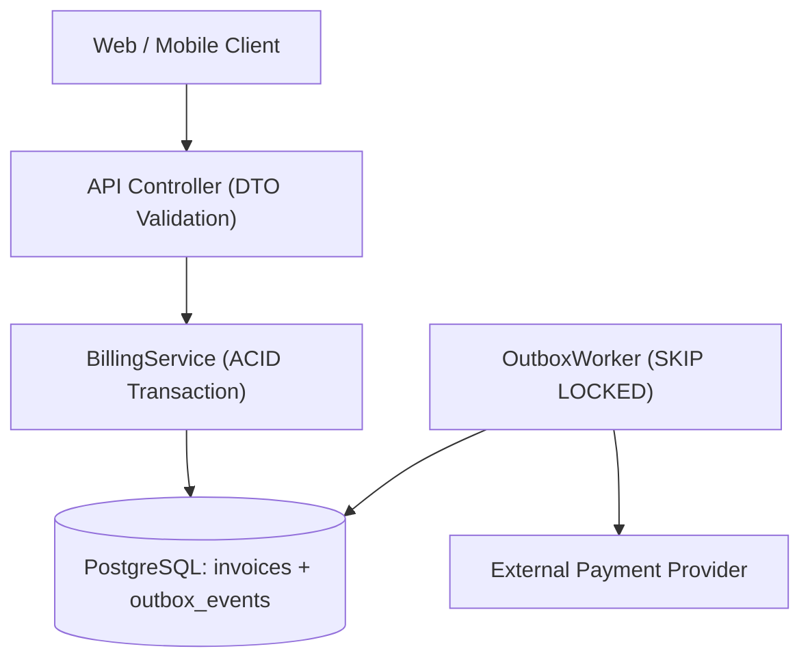

# Architecture Decision Record (ADR) & System Design Template (`akit-architecture`)

Save each significant architectural decision to `docs/adr/NNN-<decision-slug>.md` before executing irreversible cross-cutting changes.

---

```markdown
# ADR-[NNN]: [Short Title of Architectural Decision]

- **Status:** `[Proposed | Accepted | Superseded by ADR-XXX]`
- **Date:** `[YYYY-MM-DD]`
- **Deciders:** `[User / Engineering Team]`
- **Related Skills / Artifacts:** `[akit-prior-art report, akit-debate / akit-arena session]`

---

## 1. Context & Problem Statement
- **Current System State:** `[Observed modules, DB tables, and entrypoints with file:line citations]`
- **Driving Problem:** `[What concrete requirement, bottleneck, or coupling forces a decision now?]`
- **Hard Constraints & Non-Goals:**
  - Must support: `[e.g., ACID consistency for billing; zero new paid infra]`
  - Explicitly out of scope: `[e.g., Multi-region active-active replication]`

---

## 2. Component & Data-Flow Architecture (Mermaid C4 / Sequence)



---

## 3. Considered Options & Prior-Art Comparison

| Criterion | Option 1: Modular Monolith + Postgres Outbox (Recommended) | Option 2: Separate Microservice + Kafka | Option 3: Synchronous Inline HTTP Call |
| :--- | :--- | :--- | :--- |
| **Consistency & Reliability** | High (Atomic DB commit + guaranteed retry) | High, but requires ops management | Low (Lost events if provider times out after DB commit) |
| **Operational Complexity** | Low (Uses existing Postgres instance) | High (New broker, schema registry, DevOps) | Lowest |
| **Prior-Art Evidence (`akit-prior-art`)** | Proven pattern in `medusajs/medusa` | Overkill for current `<500 req/s` load | Known anti-pattern |

---

## 4. Decision & Module Boundary Rules
- **Chosen Option:** `[Option 1]`
- **Allowed Dependency Direction:** `[Controller -> BillingService -> BillingRepository]`
- **Forbidden Coupling:** `[Other modules may NOT write directly to the invoices table; must call BillingService]`

---

## 5. Consequences, Rollback & Verification Plan
- **Positive Consequences:** `[...]`
- **Tradeoffs / Risks & Mitigations:** `[e.g., Outbox table growth -> mitigated by partitioning/archiving completed events > 30 days]`
- **Rollback Strategy:** `[Feature flag / schema compatibility path]`
- **Verification Gate (`akit-test`):** `[Integration test proving crash recovery between DB commit and webhook dispatch]`
```
