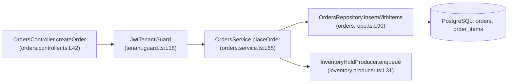

# Codebase Knowledge Graph & Blast-Radius Template (`akit-codebase`)

Use this template (inspired by `Egonex-AI/Understand-Anything` and `oraios/serena`) to map unfamiliar subsystems and assess change impact before editing code.

---

```markdown
# Codebase Investigation Map: [Subsystem / Feature Name]

## 1. Repository & Runtime Orientation
- **Entrypoints:** `[e.g., src/main.ts#L12-L48, src/orders/orders.controller.ts#L25]`
- **Core Stack & ORM:** `[e.g., NestJS 11, Prisma 6, PostgreSQL 16, BullMQ]`
- **Scoped Test Command:** `[e.g., pnpm test src/orders/]`

---

## 2. Knowledge Graph & Data-Flow Diagram



---

## 3. Semantic Symbol & Dependency Trace (`oraios/serena` Style)

| Symbol Name | Exact Location (`File:Lines`) | Layer / Role | Upstream Callers | Downstream Calls / Side Effects |
| :--- | :--- | :--- | :--- | :--- |
| `OrdersController.createOrder` | `src/orders/orders.controller.ts#L42-L59` | HTTP Transport | API Router (`POST /v1/orders`) | Validates `CreateOrderDto`, calls `OrdersService.placeOrder` |
| `OrdersService.placeOrder` | `src/orders/orders.service.ts#L65-L130` | Domain Service | `OrdersController`, `RecurringBillingJob` | Runs `$transaction`, calls `OrdersRepository`, emits `order.created` |
| `OrdersRepository.insertWithItems` | `src/orders/orders.repo.ts#L90-L145` | Persistence | `OrdersService.placeOrder` | Inserts into `orders` and `order_items` |

---

## 4. Change Blast-Radius & Invariant Analysis
- **If we modify `[Target Symbol]`:**
  1. **Direct Callers Affected:** `[List all callers — note `RecurringBillingJob` also calls `placeOrder`!]`
  2. **Database / Contract Invariants:** `[e.g., `total_cents` must equal sum of `line_items`; `idempotency_key` unique per tenant]`
  3. **Existing Tests to Run:** `[test/orders/place-order.spec.ts, test/billing/recurring.spec.ts]`
- **Unverified / Hidden Risks:** `[Any dynamic reflection, external webhook, or unindexed table]`
```
