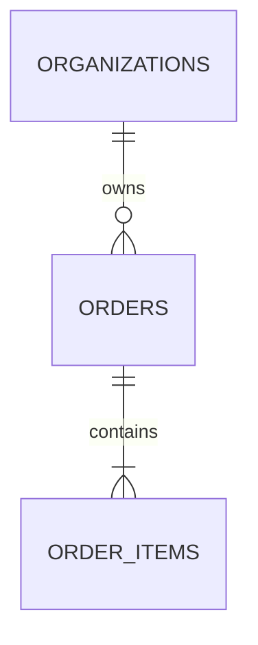

# Relational Data Modeling & Zero-Downtime Migration Playbook (`akit-data`)

Use this reference when designing entity schemas, concurrency controls, and reversible database migrations.

---

## 1. Entity & Schema Design Checklist
- [ ] **Primary Key Strategy:** Consistent `uuid` or `bigint` PK across all tables.
- [ ] **Tenant Ownership:** Multi-tenant tables include `tenant_id` / `organization_id NOT NULL` in both foreign keys and composite indexes.
- [ ] **Monetary & Decimal Precision:** All currency amounts use integer minor units (`amount_cents BIGINT`) or exact `NUMERIC(19, 4)` + explicit `currency CHAR(3)`.
- [ ] **Idempotency & Deduplication:** State-mutating operations (payments, webhooks, orders) include `idempotency_key` with `UNIQUE (tenant_id, idempotency_key)`.
- [ ] **Audit & Soft-Delete Clarity:** If soft-delete (`deleted_at`) is used, unique constraints use partial indexes (`CREATE UNIQUE INDEX ... WHERE deleted_at IS NULL`) so deleted slugs/emails can be reused!

---

## 2. Concurrency Control Decision Matrix

| Contention Scenario | Recommended Pattern | Implementation Mechanism |
| :--- | :--- | :--- |
| **Document / Profile Editing** (Low contention, human-paced) | **Optimistic Concurrency (`version` column)** | `UPDATE articles SET body = $1, version = version + 1 WHERE id = $2 AND version = $3` (0 rows updated $\rightarrow$ `409 Conflict`) |
| **Wallet / Inventory / Quota Decrement** (High contention) | **Single-Statement Conditional Atomic Update** | `UPDATE inventory SET available = available - $1 WHERE sku_id = $2 AND available >= $1 RETURNING available` |
| **Multi-Step Seat / Booking Reservation** | **Pessimistic Row Lock (`FOR UPDATE`)** | Sort target IDs ascending $\rightarrow$ `SELECT id FROM seats WHERE id = ANY($1) FOR UPDATE` $\rightarrow$ validate & update |
| **Background Queue Worker Claiming Jobs** | **Non-Blocking Skip Lock** | `SELECT id FROM jobs WHERE status = 'QUEUED' ORDER BY run_at ASC FOR UPDATE SKIP LOCKED LIMIT 10` |

---

## 3. Expand-Migrate-Contract Migration Plan Template

```markdown
# Migration Plan: [Change Description]

## 1. ERD & Table Impact


## 2. Three-Phase Zero-Downtime Rollout
- **Release 1 (Expand — Backward Compatible):**
  - DDL: `[Add nullable column / new table / concurrent index]`
  - App Code: `[Dual-write to old + new; read from old]`
- **Release 2 (Backfill & Switch Reads):**
  - Batch Script: `[Idempotent chunked backfill of 1,000 rows per batch]`
  - App Code: `[Read from new column; validate constraint NOT VALID -> VALIDATE]`
- **Release 3 (Contract — Cleanup):**
  - App Code: `[Stop writing to old column]`
  - DDL: `[Drop obsolete column after confirmation window]`

## 3. Rollback & Verification
- **Down / Rollback Action:** `[Exact SQL or app flag to revert safely]`
- **Test Verification:** `[Migration applied & rolled back cleanly on test DB]`
```
