# AKit Implement — TDD & Subagent-Driven Development (`obra/superpowers`)

## Overview
`akit-implement` governs all production code authoring and plan execution in AKit, deeply integrating **Test-Driven Development (`test-driven-development`)**, **Subagent-Driven Development (`subagent-driven-development`)**, **Parallel Agent Dispatch (`dispatching-parallel-agents`)**, and **Verification-Before-Completion** from `obra/superpowers`, alongside module-boundary practices from `shanraisshan/claude-code-best-practice` and `getsentry/skills`.

**The Iron Law:** `NO PRODUCTION CODE WITHOUT A FAILING TEST FIRST.` If you write production code before watching a test fail for the expected reason, delete the production code and start over from the test.

---

## Pre-Implementation Mandatory Familiarity Gate (`akit-prior-art`)
- **Mandatory Rule:** *"Đối với những chức năng chưa quen thuộc, đừng viết từ con số 0, hãy tìm kiếm các dự án mã nguồn mở trên GitHub để so sánh ý tưởng trước khi bắt tay vào làm."*
- Before creating a new module or feature, ask: *Does this repository already have an established pattern for this capability?*
- If the capability is unfamiliar (e.g., OAuth/PKCE, webhook signature verification, distributed seat locking, streaming parsers, idempotency middleware), **STOP** and run `akit-prior-art` first: search GitHub for 2–3 mature open-source projects, compare their designs and edge cases, verify licenses, and decide **Adopt / Adapt / Build** before writing code.

---

## Antigravity Native Tool Mapping
1. **Inspect Surrounding Conventions (`read_file`):** Read neighboring controllers, services, repositories, and test files to mirror naming, error handling, and DI conventions.
2. **Surgical Edits (`edit_file` / `write_file`):** Apply narrow, cohesive patches. Never reformat unrelated lines or touch out-of-scope files.
3. **Execute TDD Cycles (`run_command`):**
   - Run the single targeted test file in RED and GREEN phases for fast feedback.
   - Record machine-verifiable evidence via `python .akit/runtime/akit_cli.py checks --out .akit/evidence.json -- <test-command>`.
4. **Subagent-Driven Development (`invoke_subagent` / `send_message`):**
   - When executing multi-task plans, follow `references/subagent-driven-development-protocol.md`: maintain `.superpowers/sdd/<plan>/progress.md`, dispatch per-task implementers with file-based briefs, enforce the 4-status contract (`DONE`, `DONE_WITH_CONCERNS`, `NEEDS_CONTEXT`, `BLOCKED`), and run two-stage task reviews with a 5-round fix loop breaker.
5. **Post-Green Simplification:** After tests turn GREEN, invoke `akit-simplify` (`getsentry/skills`) to remove accidental complexity while keeping tests green.

---

## Step-by-Step Implementation Workflow (`RED -> GREEN -> REFACTOR`)

```dot
digraph akit_tdd {
    rankdir=LR;
    red [label="1. RED\nWrite 1 failing test", shape=box];
    watch_red [label="2. WATCH IT FAIL\nConfirm expected failure reason", shape=diamond];
    green [label="3. GREEN\nWrite minimal production code", shape=box];
    watch_green [label="4. WATCH IT PASS\nTargeted + regression suite", shape=diamond];
    refactor [label="5. REFACTOR & SIMPLIFY\nClean boundaries (akit-simplify)", shape=box];

    red -> watch_red;
    watch_red -> green [label="fails as expected"];
    watch_red -> red [label="passes or syntax error"];
    green -> watch_green;
    watch_green -> refactor [label="all green"];
    watch_green -> green [label="fails"];
}
```

### Step 1: Write the Failing Test First (`RED`)
1. Translate the first acceptance criterion into a clear behavior test (Unit test for domain logic; Integration test for API/DB boundary).
2. Assert on **real observable behavior** and return values, not mock internals (`references/tdd-and-implementation-checklist.md`).

### Step 2: Watch the Test Fail (`Verify RED`)
1. Run the test command via `run_command`.
2. Confirm the test fails because the feature/fix is not yet implemented — not because of a broken import, syntax error, or misconfigured fixture.

### Step 3: Write Minimal Cohesive Code (`GREEN`)
1. Respect strict layer separation:
   - **Transport / Controller / UI Handler:** Input parsing, DTO validation, HTTP status mapping.
   - **Application / Domain Service:** Business invariants, authorization checks, transaction orchestration.
   - **Repository / Data Layer:** Parameterized queries, persistence mapping, zero business branching.
2. Enforce explicit types and return shapes; forbid `any`, silent `catch {}` blocks, or hardcoded secrets.
3. Write only the code needed to pass the current test — do not add speculative flags or unrequested features (YAGNI).

### Step 4: Watch the Test Pass & Run Regressions (`Verify GREEN`)
1. Re-run the targeted test and watch it pass.
2. Run the module's regression test suite, typechecker (`tsc --noEmit` / `mypy` / `pyright`), and linter.

### Step 5: Refactor, Simplify & Record SDD Ledger (`REFACTOR`)
1. Apply `akit-simplify` heuristics (`references/tdd-and-implementation-checklist.md`): flatten nested conditionals with guard clauses, extract duplicated domain predicates, and verify tests remain green.
2. When running under Subagent-Driven Development (`references/subagent-driven-development-protocol.md`), record `BASE_SHA..HEAD_SHA`, dispatch the task reviewer, and append completion or `Ruling:` entries to `.superpowers/sdd/<plan>/progress.md`.

---

## Red Flags & Rationalization Counter-Table

| Common Excuse / Rationalization | Engineering Reality & Mandatory Action |
| :--- | :--- |
| *"This change is too simple to need a failing test first."* | Simple changes break production every day. Writing the test takes 60 seconds and proves the wiring works. |
| *"I'll write the production code first and add tests right after."* | Tests written after code are biased by your implementation and never proved they could catch the bug. Delete the code and write the test first. |
| *"In SDD mode, I'll fix the subagent's review findings myself in the controller session."* | Controller fixes pollute coordinator context and bypass the scoped re-review gate (`references/subagent-driven-development-protocol.md`). Resume the implementer. |
| *"Let me also refactor these 6 unrelated files while I'm here."* | Unrelated edits pollute git blame and create merge conflicts (`akit-git`). Keep diffs strictly scoped to the task. |

---

## Safety & Exit Gates
- Never introduce a new third-party dependency in `package.json`, `pyproject.toml`, or `Cargo.toml` without explicit user justification and license check.
- Never claim tests, linters, or builds passed without running the actual command in the current turn (`verification-before-completion`).
- If a test environment is unavailable, report `BLOCKED` with the exact missing service or credential rather than claiming completion.

## Reference Materials & Attribution
- TDD cycle checklist, layer boundary rules, and verification contract: `references/tdd-and-implementation-checklist.md`
- Subagent-Driven Development (SDD) ledger, 4-status contract, 5-round fix loop breaker, and parallel dispatch rules: `references/subagent-driven-development-protocol.md`
- Inspired by `obra/superpowers` (`test-driven-development`, `subagent-driven-development`, `dispatching-parallel-agents`, `verification-before-completion`), `shanraisshan/claude-code-best-practice`, and `getsentry/skills`. Original AKit instructions.
