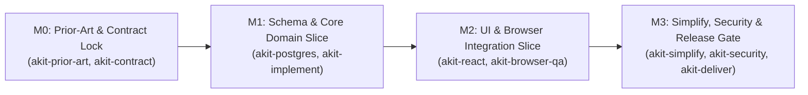

# Vertical Slice Implementation Plan Template (`akit-plan`)

Use this template (informed by `obra/superpowers` `writing-plans` and `datawhalechina/easy-vibe`) to write clear, verifiable execution plans before touching production code.

---

```markdown
# Implementation Plan: [Feature / Project Name]

## 1. Goal, Architecture & Scope Summary
- **Objective:** `[1-2 sentence summary of what this plan delivers]`
- **Prior-Art / ADR Reference:** `[Link to docs/prior-art/... or docs/adr/... if applicable]`
- **Explicit Non-Goals:** `[What is excluded from this plan]`
- **Baseline Test Command:** `[e.g., pnpm test / python -m unittest discover -s tests -v]`

---

## 2. Milestone & Dependency Graph



---

## 3. Bite-Sized Vertical Slice Tasks (TDD Ordered)

### Task 1: [Contract & Schema Foundation]
- **Assigned Owner / Scope (`akit-git`):** `[Main Agent | Worker 1]`
- **Files to Create / Modify:**
  - Create: `test/invitations/create-invitation.spec.ts`
  - Modify: `prisma/schema.prisma`
  - Create: `src/invitations/dto/create-invitation.dto.ts`
- **Execution Steps (RED -> GREEN -> REFACTOR):**
  - [ ] **1.1 (RED):** Write failing integration test in `test/invitations/create-invitation.spec.ts` asserting duplicate `(orgId, email)` returns `409 Conflict`.
  - [ ] **1.2 (Verify RED):** Run `pnpm test create-invitation.spec.ts` and confirm it fails as expected.
  - [ ] **1.3 (GREEN):** Add `Invitation` model + unique index `(org_id, email) WHERE status = 'PENDING'` and implement `InvitationsService.create`.
  - [ ] **1.4 (Verify GREEN):** Re-run `pnpm test create-invitation.spec.ts` and `pnpm typecheck` -> confirm Exit `0`.
  - [ ] **1.5 (Simplify):** Run `akit-simplify` pass on `InvitationsService.create`.
- **Rollback Plan:** `[Revert migration and service files if check fails]`

---

### Task 2: [Frontend Interactive Slice & Browser QA]
- **Dependencies:** Requires Task 1 `GREEN`
- **Files to Create / Modify:**
  - Create: `src/features/invitations/InviteMemberModal.tsx`
  - Create: `e2e/invitations.spec.ts`
- **Execution Steps:**
  - [ ] **2.1 (RED):** Write component/Playwright test for empty email validation, loading state, and `409` duplicate error banner.
  - [ ] **2.2 (GREEN):** Implement `InviteMemberModal` using `DESIGN.md` tokens (`akit-design`, `akit-react`).
  - [ ] **2.3 (Verify GREEN):** Run `npx playwright test e2e/invitations.spec.ts` -> confirm Exit `0` at Desktop & Mobile viewports.

---

## 4. Human Approval & Release Checkpoints
- [ ] **Checkpoint A (Before DB Migration):** User approves `prisma/migrations/.../migration.sql`.
- [ ] **Checkpoint B (Before Merge / Deploy):** All unit, integration, security, and browser QA checks pass (`akit-deliver`).
```
