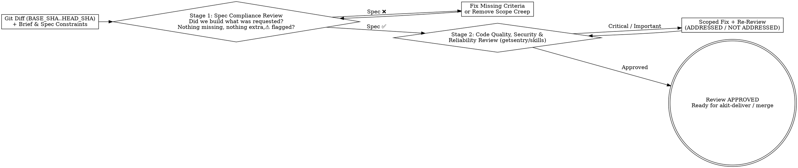

# AKit Review — Two-Stage Adversarial Review & Technical Feedback Reception

## Overview
`akit-review` combines the **Two-Stage Code Review** (`requesting-code-review`), **Scoped Re-Review** (`subagent-driven-development`), and **Technical Review Reception** (`receiving-code-review`) protocols from `obra/superpowers` with the engineering review heuristics and error-context discipline of `getsentry/skills`, `trailofbits/skills`, and `shanraisshan/claude-code-best-practice`.

**Core principle:** Never mix spec-compliance checking with code-style critique in a single unfocused pass, never pre-judge findings when dispatching a reviewer, and never accept or reject review feedback performatively (`"You're absolutely right!"`) without technical verification (`references/receiving-and-requesting-review.md`).

---

## The Two-Stage Review Architecture (`obra/superpowers`)

---

## Antigravity Native Tool Mapping
1. **Package Exact Diff Range (`run_command` / `write_file`):**
   - Record `BASE_SHA` before work starts and `HEAD_SHA` on completion (never use `HEAD~1` on multi-commit tasks).
   - Inspect `git diff --stat BASE_SHA..HEAD_SHA` and `git diff -U10 BASE_SHA..HEAD_SHA` (`references/receiving-and-requesting-review.md`).
2. **Delegate Independent Adversarial Review (`invoke_subagent`):**
   - Dispatch `.agents/agents/akit-critic.md` with the brief, global constraints, implementer report, and diff package. Never include pre-judging instructions (`"do not flag X"`).
   - For auth/crypto/SQL/RLS diffs, also dispatch `.agents/agents/akit-security.md`.
3. **Structured Output:** Format findings using `references/review-checklist.md` and `references/receiving-and-requesting-review.md`.

---

## Step-by-Step Code Review Workflow

### Step 1: Stage 1 — Spec & Contract Compliance Audit
Compare the implementation against the approved user request, `docs/requirements.md`, and API contracts (`akit-contract`):
1. **Missing Requirements:** Is every acceptance criterion and edge case implemented and tested?
2. **Extra / Scope Creep (YAGNI):** Did the diff modify unrelated files, introduce unrequested endpoints/flags, or break backward compatibility?
3. **Unverifiable From Diff (`⚠️ Cannot verify from diff`):** Flag cross-task or unchanged-file requirements explicitly so the controller verifies them before marking the task complete.

### Step 2: Stage 2 — Correctness, Security, Error Telemetry & Maintainability (`getsentry/skills`)
Audit the diff across 5 critical dimensions (`references/review-checklist.md`):
1. **Correctness & Concurrency:** Off-by-one errors, null/undefined paths, race conditions (check-then-act without locks), unawaited promises, broken transaction rollback.
2. **Security & Trust Boundaries (`akit-security`):** Missing resource-level authorization (BOLA/IDOR), raw SQL interpolation, SSRF, XSS, or leaked secrets/password hashes in DTOs.
3. **Database & Performance (`akit-postgres`, `akit-performance`):** N+1 queries inside loops, unindexed `WHERE` predicates, unbounded `findAll()` without pagination, blocking migrations.
4. **Error Handling & Telemetry (`getsentry/skills`):** Swallowed exceptions (`catch (e) {}`), generic `500` errors hiding actionable context, or logs leaking PII/tokens.
5. **Test Honesty (`akit-test`):** Do the tests actually exercise the new code paths and failure cases, or do they only test mocks?

### Step 3: Receiving & Acting on Review Feedback (`receiving-code-review`)
When receiving review findings from a human partner or reviewer subagent (`references/receiving-and-requesting-review.md`):
1. Follow **`READ -> UNDERSTAND -> VERIFY -> EVALUATE -> RESPOND -> IMPLEMENT`**.
2. **Forbid Performative Agreement:** Never say *"You're absolutely right!"*, *"Great point!"*, or *"Thanks for catching that!"*.
3. **Clarify All Unclear Items First:** If items 1–3 are clear but item 4 is ambiguous, stop and clarify item 4 before implementing 1–3.
4. **YAGNI Grep Check:** If a reviewer suggests "implementing X properly", grep the codebase for callers first; if unused, propose removing it (YAGNI).

---

## Red Flags & Rationalization Counter-Table

| Common Excuse / Rationalization | Engineering Reality & Mandatory Action |
| :--- | :--- |
| *"You're absolutely right! Let me implement that suggestion immediately."* | Explicit violation of `receiving-code-review` (`references/receiving-and-requesting-review.md`). Verify against codebase reality first and state technical facts, never performative praise. |
| *"I'll just review the diff myself inline instead of dispatching `akit-critic`."* | Self-reviewing inline burns coordinator context and suffers from author bias. Dispatch `.agents/agents/akit-critic.md` for an independent gate. |
| *"I'll report 15 minor naming opinions as Critical blocking bugs."* | Noise drowns out real defects. Strictly separate **`Critical` / `Important`** defects with `file:line` proof from **`Minor`** suggestions (which are deferred to the ledger). |
| *"I reviewed only the 20 lines in the git diff without checking callers."* | Diffs out of context hide broken caller contracts. Inspect callers when shared signatures or state change (`akit-codebase`). |

---

## Safety & Exit Gates
- Never approve a diff with unverified test status or unresolved `Critical` / `Important` security or correctness findings.
- Never claim a comprehensive security audit was performed when only a general code review was executed.

## Reference Materials & Attribution
- Two-stage review scorecard, severity rubric, and report template: `references/review-checklist.md`
- Requesting review (`BASE_SHA..HEAD_SHA`), scoped re-reviews, anti-performative reception, and YAGNI checks: `references/receiving-and-requesting-review.md`
- Inspired by `obra/superpowers` (`requesting-code-review`, `receiving-code-review`, `subagent-driven-development`), `getsentry/skills`, and `trailofbits/skills`. Original AKit instructions.
